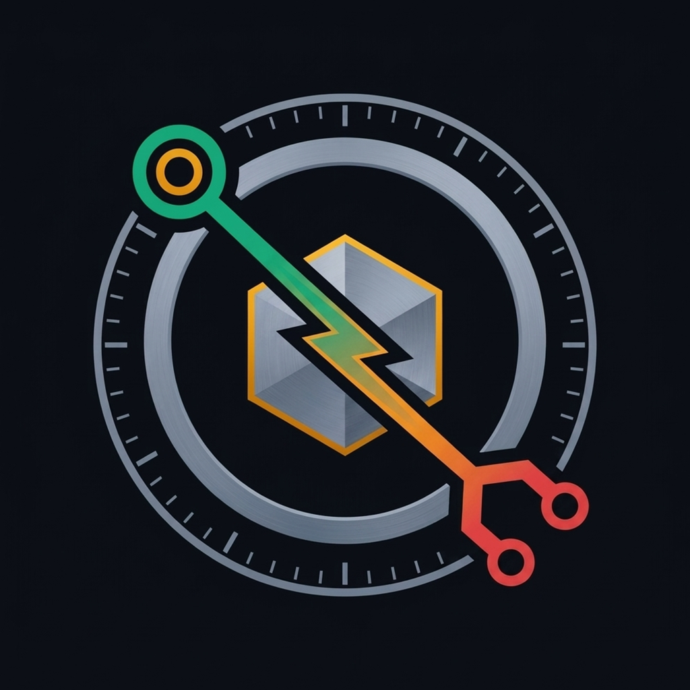
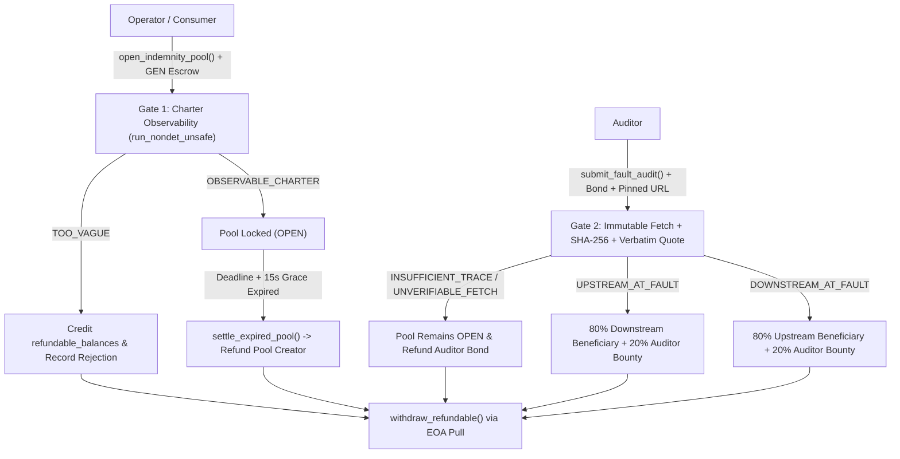

# CASCADE — Bilateral AI-Service Indemnity & Fault-Attribution Protocol

<p align="center">
  
</p>

**Cascade** is a bilateral AI-service indemnity and causal fault-attribution protocol built on **GenLayer StudioNet (Chain ID `61999`)**. When an upstream AI provider/router and a downstream application experience an outage or SLA breach, Cascade evaluates immutable, commit-pinned post-mortem evidence through a two-gate Optimistic Democracy consensus pipeline and routes escrowed collateral automatically:

- **80% indemnity** to the exonerated party (`downstream_beneficiary` on `UPSTREAM_AT_FAULT`, or `upstream_beneficiary` on `DOWNSTREAM_AT_FAULT`)
- **20% auditor bounty + returned audit bond** to the submitting auditor
- **Pull-based escrow withdrawals** via `withdraw_refundable()` and `settle_expired_pool()`

---

## Architecture



---

## Live StudioNet Deployment

- **Network:** GenLayer StudioNet (`Chain ID 61999`, RPC `https://studio.genlayer.com/api`)
- **Cascade Contract:** [`0x25e9785bf2dE3d1AD2dDE7778dd090f0a5114937`](https://explorer-studio.genlayer.com/address/0x25e9785bf2dE3d1AD2dDE7778dd090f0a5114937)
- **Deploy Tx:** [`0x706bc6c5255f9b5b4ebc81534cf19a070149cb58c6594ce1e713daf8b6cca994`](https://explorer-studio.genlayer.com/tx/0x706bc6c5255f9b5b4ebc81534cf19a070149cb58c6594ce1e713daf8b6cca994)
- **Contract Source SHA-256:** `db37ee24afc149d700a41c66fce41788e8f861e14268ed32e6630a12086a0c0c`
- **EvidenceProbe Contract:** [`0x7A500B8D5FD75A28aA282Be6ECF274f49d6D7dc8`](https://explorer-studio.genlayer.com/address/0x7A500B8D5FD75A28aA282Be6ECF274f49d6D7dc8)

### Finalized 7-Case StudioNet Proof Bundle (`deploy/proof.json`)

| Exhibit | Case | Verdict : Reason Code | StudioNet Tx |
| :--- | :--- | :--- | :--- |
| `EX-01` | Gate-1 TOO_VAGUE Charter Rejection & Deposit Refund | `TOO_VAGUE : SUBJECTIVE_OR_UNMEASURABLE` | [`0x6ce14301...`](https://explorer-studio.genlayer.com/tx/0x6ce143013d5ac98b85a4f3b8f62c546f2988654a115f3d85d26549f84e11a36b) |
| `EX-02` | Gate-1 OBSERVABLE_CHARTER Pool #1–#4 Creation | `OBSERVABLE_CHARTER : CONCRETE_CAUSAL_CHARTER` | [`0x8f21ffc6...`](https://explorer-studio.genlayer.com/tx/0x8f21ffc651bb8cc6010637403318a19144357eb339db56ceb6bec8432e63831f) |
| `EX-03` | Upstream Fault: Cloudflare Miami BGP Routing Defect (Pool #1) | `UPSTREAM_AT_FAULT : UPSTREAM_CONFIG_OR_ROUTING_DEFECT` | [`0x55d2fd0c...`](https://explorer-studio.genlayer.com/tx/0x55d2fd0cc12850ea284c36a894abfb99df36ba8204c91192e7b22f9fa7334efe) |
| `EX-04` | Downstream Fault: Workers KV Cloud Store Outage (Pool #2) | `DOWNSTREAM_AT_FAULT : DOWNSTREAM_STORAGE_OR_DB_OUTAGE` | [`0x77b3c442...`](https://explorer-studio.genlayer.com/tx/0x77b3c442f3f73b589d3c471be7b7dd816586b03a127056d0ee210617b100b404) |
| `EX-05` | Insufficient Trace: Unrelated Telemetry Window (Pool #3, Attempt 1) | `INSUFFICIENT_TRACE : NO_CAUSAL_PROOF_IN_SLICE` | [`0xd2b11eb4...`](https://explorer-studio.genlayer.com/tx/0xd2b11eb4d6cc5243d41b76591563a351f6575948eec9c5087c57e33bc1c70fe5) |
| `EX-06` | Insufficient Trace: Adversarial Prompt Injection Ignored (Pool #3, Attempt 2) | `INSUFFICIENT_TRACE : ADVERSARIAL_INJECTION_IGNORED` | [`0x71c7d835...`](https://explorer-studio.genlayer.com/tx/0x71c7d835c3a382fdf9b211b85484330ade199960f21a03ad944892bb972a0ba0) |
| `EX-07` | Short-Window Expiry Settlement & EOA Native Withdrawals (Pool #4) | `EXPIRED_REFUNDED : POOL_DEADLINE_EXPIRED` | [`0xde3ba686...`](https://explorer-studio.genlayer.com/tx/0xde3ba6861218aff272566020e1ea6f092325fa9b1460e4beea5682e7f569e0dc) |

---

## Quickstart & Verification

```bash
# 1. Run Python contract unit tests
pytest tests/test_cascade.py -v

# 2. Independently verify all 7 StudioNet exhibits + RPC parity
python deploy/verify_proof.py

# 3. Install, test, and build the frontend telemetry console
npm --prefix frontend install
npm --prefix frontend run test
npm --prefix frontend run build

# 4. Launch local dev server
npm run dev
```

---

## Documentation

- [Developer Tutorial](docs/TUTORIAL.md) — 2-gate consensus pipeline, `VERDICT_COMPATIBLE_REASONS`, bilateral 80/20 routing, and SHA-256 anchoring.
- [Steward Demo Script](docs/DEMO_SCRIPT.md) — 2-minute walkthrough of Dossiers, Indemnity Desk, and Consensus Telemetry.

---

## Honest Limitations

- **External Origin Allowlist**: Evidence URLs are restricted to immutable HTTPS snapshots on `raw.githubusercontent.com` (40-hex commit SHA), `web.archive.org` (`/web/<14-digit>id_/`), and `en.wikipedia.org` (`/w/api.php?action=parse&oldid=<digits>`). Arbitrary private webhooks or mutable URLs are intentionally rejected.
- **Line Window & Snippet Cap**: Audits inspect up to `120` lines and `3,000` normalized characters per submission to keep validator LLM prompts deterministic and bounded.
- **Wallet Requirement for Writes**: Read-only RPC verification and browser WebCrypto SHA-256 checks work without a wallet; submitting pools, audits, appeals, or withdrawals requires MetaMask connected to GenLayer StudioNet (`Chain ID 61999`).
