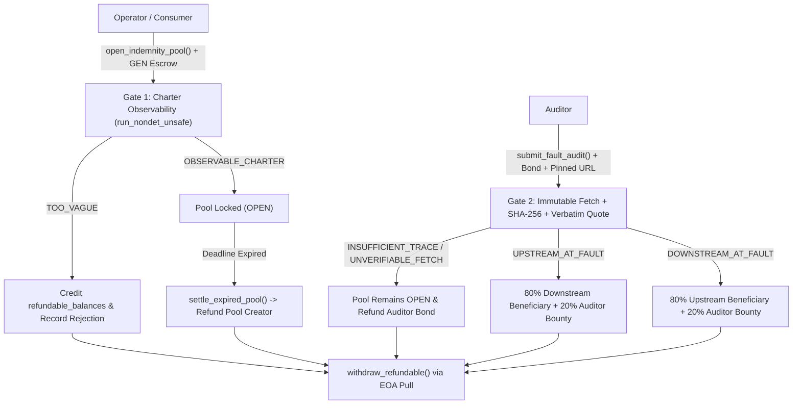

# CASCADE — Bilateral AI-Service Indemnity & Fault-Attribution Protocol

<p align="center">
  
</p>

**Cascade** is a bilateral AI-service indemnity and causal fault-attribution protocol built on **GenLayer StudioNet (Chain ID `61999`)**. When an upstream AI provider/router and a downstream application experience an outage or SLA breach, Cascade evaluates immutable, commit-pinned post-mortem evidence through a two-gate Optimistic Democracy consensus pipeline and routes escrowed collateral automatically:

- **80% indemnity** to the exonerated party (`downstream_beneficiary` on `UPSTREAM_AT_FAULT`, or `upstream_beneficiary` on `DOWNSTREAM_AT_FAULT`)
- **20% auditor bounty + returned audit bond** to the submitting auditor
- **Pull-based escrow withdrawals** via `withdraw_refundable()` and `settle_expired_pool()`

---

## Architecture



---

## Live StudioNet Deployment

- **Network:** GenLayer StudioNet (`Chain ID 61999`, RPC `https://studio.genlayer.com/api`)
- **Cascade Contract:** [`0x800450113F99B1BBb3136363a22AB39fE92F3d5e`](https://explorer-studio.genlayer.com/address/0x800450113F99B1BBb3136363a22AB39fE92F3d5e)
- **Deploy Tx:** [`0xca847cb199d4979b3b306f43533b4a85333e2735daaaf52a1f9ffb8f25345586`](https://explorer-studio.genlayer.com/tx/0xca847cb199d4979b3b306f43533b4a85333e2735daaaf52a1f9ffb8f25345586)
- **Contract Source SHA-256:** `65488d3e0f45f3565f8b677128705a1722648406e7b1948f72c4470fda62d44f`
- **EvidenceProbe Contract:** [`0x7A500B8D5FD75A28aA282Be6ECF274f49d6D7dc8`](https://explorer-studio.genlayer.com/address/0x7A500B8D5FD75A28aA282Be6ECF274f49d6D7dc8)

### Finalized 7-Case StudioNet Proof Bundle (`deploy/proof.json`)

| Exhibit | Case | Verdict : Reason Code | StudioNet Tx |
| :--- | :--- | :--- | :--- |
| `EX-01` | Gate-1 TOO_VAGUE Charter Rejection & Deposit Refund | `TOO_VAGUE : SUBJECTIVE_OR_UNMEASURABLE` | [`0x40e2510a...`](https://explorer-studio.genlayer.com/tx/0x40e2510a6b7062660960b8816aec21f34fa43fd2b8d4e1ad6b7563897a565715) |
| `EX-02` | Gate-1 OBSERVABLE_CHARTER Pool #1–#4 Creation | `OBSERVABLE_CHARTER : CONCRETE_CAUSAL_CHARTER` | [`0xa986cdc7...`](https://explorer-studio.genlayer.com/tx/0xa986cdc73212ced7c9048050276751fd0b737ff5b448ed1ceccdfad322c8c84e) |
| `EX-03` | Upstream Fault: Cloudflare Miami BGP Routing Defect (Pool #1) | `UPSTREAM_AT_FAULT : UPSTREAM_CONFIG_OR_ROUTING_DEFECT` | [`0x70a3cb7f...`](https://explorer-studio.genlayer.com/tx/0x70a3cb7f6f206cc050a649e8ac01791dc8b018e96879e46308bb8302cfbf60f3) |
| `EX-04` | Downstream Fault: Workers KV Cloud Store Outage (Pool #2) | `DOWNSTREAM_AT_FAULT : DOWNSTREAM_STORAGE_OR_DB_OUTAGE` | [`0x3363abbd...`](https://explorer-studio.genlayer.com/tx/0x3363abbd6613e2745467d02afa88569dd8c232a769b6f58e4003869325e8ed22) |
| `EX-05` | Insufficient Trace: Unrelated Telemetry Window (Pool #3, Attempt 1) | `INSUFFICIENT_TRACE : NO_CAUSAL_PROOF_IN_SLICE` | [`0x14e7ced8...`](https://explorer-studio.genlayer.com/tx/0x14e7ced83afde84d3739abef89fe0f3f9cb4c755614d81342a4580b2de146f59) |
| `EX-06` | Insufficient Trace: Adversarial Prompt Injection Ignored (Pool #3, Attempt 2) | `INSUFFICIENT_TRACE : ADVERSARIAL_INJECTION_IGNORED` | [`0x5ee5969c...`](https://explorer-studio.genlayer.com/tx/0x5ee5969cc4749da4bc2097496e9062db835553d02b86b04a17bf51d3e63e64cc) |
| `EX-07` | Short-Window Expiry Settlement & EOA Native Withdrawals (Pool #4) | `EXPIRED_REFUNDED : POOL_DEADLINE_EXPIRED` | [`0xcbf5cc5a...`](https://explorer-studio.genlayer.com/tx/0xcbf5cc5a631568eff1c6ab09a8594b5a6dd8ab3a5d1d787d33d633b0eb4aa264) |

---

## Quickstart & Verification

```bash
# 1. Run Python contract unit tests
pytest tests/test_cascade.py -v

# 2. Independently verify all 7 StudioNet exhibits + RPC parity
python deploy/verify_proof.py

# 3. Install, test, and build the frontend telemetry console
npm --prefix frontend install
npm --prefix frontend run test
npm --prefix frontend run build

# 4. Launch local dev server
npm run dev
```

---

## Documentation

- [Developer Tutorial](docs/TUTORIAL.md) — 2-gate consensus pipeline, `VERDICT_COMPATIBLE_REASONS`, bilateral 80/20 routing, and SHA-256 anchoring.
- [Steward Demo Script](docs/DEMO_SCRIPT.md) — 2-minute walkthrough of Dossiers, Indemnity Desk, and Consensus Telemetry.

---

## Honest Limitations

- **External Origin Allowlist**: Evidence URLs are restricted to immutable HTTPS snapshots on `raw.githubusercontent.com` (40-hex commit SHA), `web.archive.org` (`/web/<14-digit>id_/`), and `en.wikipedia.org` (`/w/api.php?action=parse&oldid=<digits>`). Arbitrary private webhooks or mutable URLs are intentionally rejected.
- **Line Window & Snippet Cap**: Audits inspect up to `120` lines and `3,000` normalized characters per submission to keep validator LLM prompts deterministic and bounded.
- **Wallet Requirement for Writes**: Read-only RPC verification and browser WebCrypto SHA-256 checks work without a wallet; submitting pools, audits, appeals, or withdrawals requires MetaMask connected to GenLayer StudioNet (`Chain ID 61999`).
